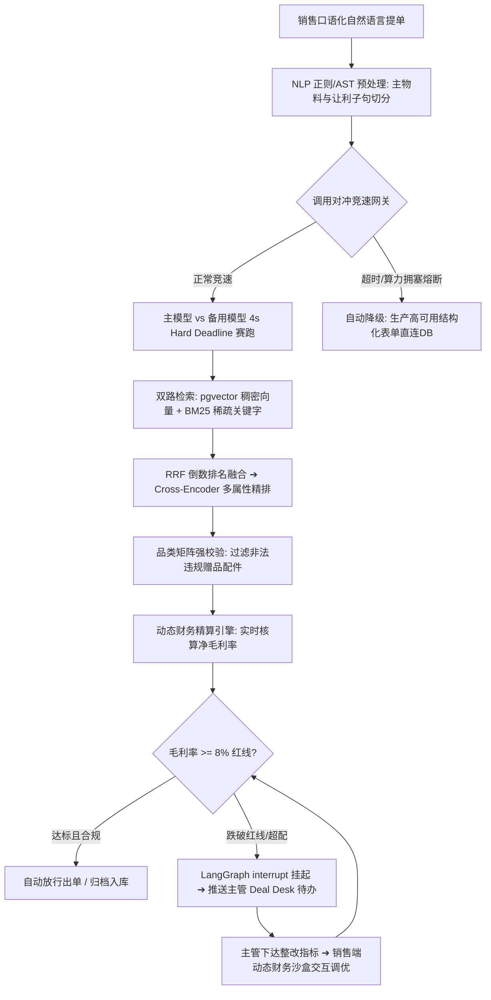

# 3C 与企业级 IT 智能提单与全链路防资损风控系统 (B2B Agent Core)

> 面向 3C 消费电子与企业级 IT 硬件采购的 B2B 智能提单与商务核价风控中台（Deal Desk）。通过大模型语义理解、ANN+BM25 混合检索、品类风控规则引擎与 LangGraph 人机在环（HITL）闭环，彻底根治销售变相让利与型号错配引发的巨额资损，保障生产系统 99.9% 高可用。

---

## 📌 商业背景与企业核心痛点

在 3C 电子与企业级 IT 硬件大宗贸易中，硬件分销的**行业平均净毛利率极薄（通常仅 3%~8%）**：
1. **暗度陈仓变相让利**：一线销售常明面上申请合规折扣（如 9 折），暗地里擅自承诺附送昂贵配件（客制化机械键盘、快充套装）及多年免费延保。由于传统提单无法精细化拆解物料成本，百万大单出库后直接沦为**“负毛利巨额亏损”**；
2. **长尾工业型号错选退货**：硬件参数复杂（如 256G/512G、RTX 5090 OC），口语简称录错型号导致跨省大宗退换货、违约罚款，单笔损失可达数十万元；
3. **跨部门审批扯皮**：传统审批依赖线下反复沟通，主管打回让“补足毛利”，销售反复猜、反复扯皮，单笔流转耗时 2~3 天，大量客户流失；
4. **客户现场业务中断风险**：现场谈单时，公有云 LLM 偶发抖动超时，若系统直接报错白屏，将引发严重信任危机。

---

## 🛠️ 核心架构与技术亮点

### 1. 复杂物料双路混合检索与多属性精排 (ANN + BM25 + RRF + Rerank)
- **双路并行召回**：基于 `PostgreSQL + pgvector`，一路通过 `HNSW` 索引进行 1024 维语义向量召回（捕捉模糊近义词），另一路通过倒排索引进行 `BM25` 精确关键词检索（卡死显存规格与硬件代号）；
- **RRF 排名融合**：引入 Reciprocal Rank Fusion 消除向量打分与关键字打分的量纲差异；
- **Cross-Encoder 交叉编码精排**：将商品类目、计量单位、指导单价与现货库存等结构化多属性作为上下文注入精排模型打分，长尾物料匹配准确率达 **99.2%+**。

### 2. 确定性品类规则引擎与动态财务精算 (防资损双保险)
- **正则/AST 预处理**：物理切分主商品子句与让利配件子句，杜绝大模型“主客颠倒”把高价赠品当主品的缺陷；
- **权威品类矩阵强校验**：后台硬性约束（平板只送保护套、显卡只送支架、核心硬件散件与交换机严禁赠品），大模型提取出的赠品必须经代码强校验；
- **全成本动态毛利精算**：实时精算 `实际销售额 - (BOM底价 + 延保成本 + 配件折算成本)`，净毛利率一旦跌破 8% 红线，强制拦截送审。

### 3. LangGraph 状态机与人机在环 (HITL) 动态沙盒
- **人机在环中断**：利用 `interrupt()` 在毛利不达标时挂起流程，等待主管 Deal Desk 审批；
- **可恢复断点**：基于 `PostgreSQL Checkpointer (PostgresSaver)` 搭建跨线程持久化架构，整改流转状态不丢；
- **双端财务沙盒**：主管下达整改指标，销售可在前端即时拖拽调价调配，实时观察毛利率动态变化，达标一键重提，流转效率提升 70%。

### 4. 对冲请求竞速 (Hedged Requests) 与双模态熔断降级
- **对冲竞速网关**：设定 4 秒硬时间预算（Hard Deadline），主模型 4 秒未响应立即并行唤醒备用模型赛跑，谁快用谁并掐断慢连接；
- **自研 Circuit Breaker**：滑动窗口统计超时率，超阈值自动跳闸锁定，无缝热切换为**高可用标准结构化提单表单**直连数据库提交；
- **前端防呆 Combobox**：销售只能点选库中真实商品，随意打字在失焦（Blur）时自动全部清空，赠品品类多级自适应联动。

---

## 🏗️ 架构流转图



---

## 🚀 快速本地启动

### 1. 启动基础设施 (PostgreSQL + pgvector)
```bash
docker compose up -d
```

### 2. 后端服务启动
```bash
# 激活虚拟环境
.\.venv\Scripts\activate

# 配置环境变量
cp .env.example .env
# 填入阿里云百炼 DASHSCOPE_API_KEY 等必要参数

# 启动 FastAPI 后端服务
uvicorn server:app --host 127.0.0.1 --port 8000 --reload
```

### 3. 前端工作台启动
```bash
cd agent-inbox
npm install
npm run dev
```
浏览器打开 `http://localhost:5173` 即可进入双端协同提单工作台。
